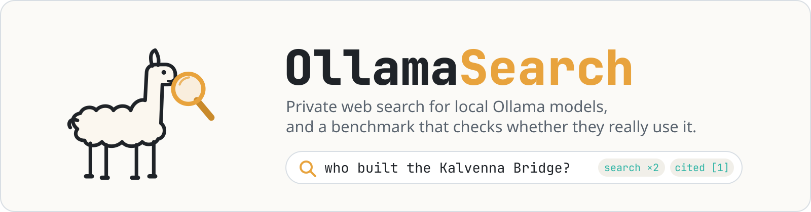
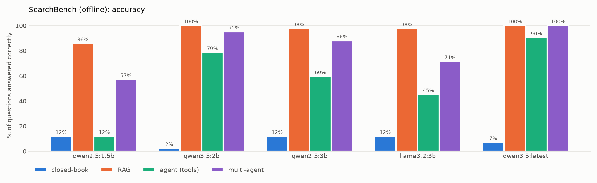
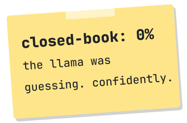
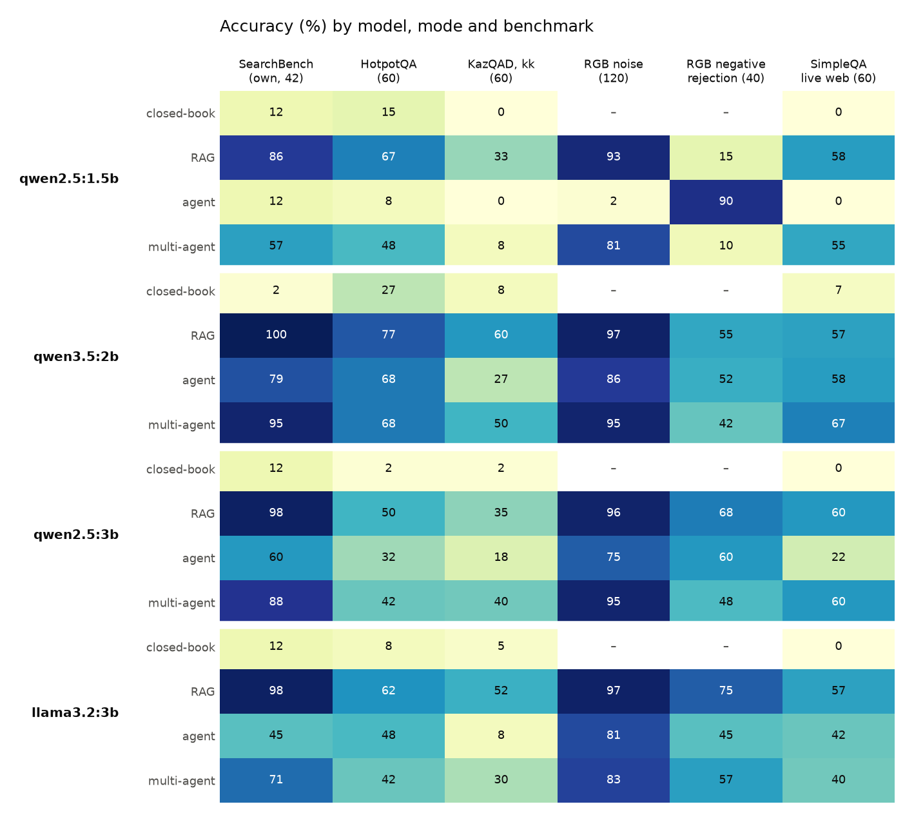
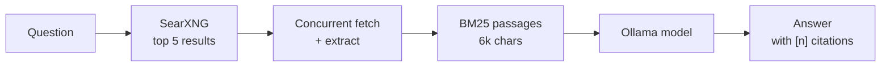
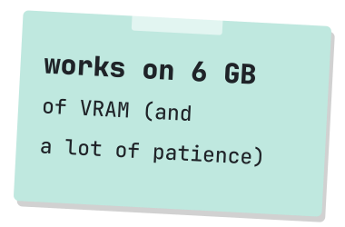

<div align="center">

<picture>
  <source media="(prefers-color-scheme: dark)" srcset="docs/img/readme/banner-dark.png">
  
</picture>

<br>


**[Quick start](#quick-start) · [SearchBench results](#searchbench-results) · [Published benchmarks](#published-benchmarks) · [How it works](#how-it-works) · [Methodology](docs/benchmark.md)**

</div>

OllamaSearch gives a local Ollama model a private search engine. It searches through your own
[SearXNG](https://github.com/searxng/searxng) instance, fetches pages concurrently, keeps only the passages that matter
and answers with numbered citations. No search API key, and nothing leaves your machine except the search queries
themselves.

It also ships **SearchBench**, a reproducible benchmark that asks a simple question: *when you give a small local model
web search, does it actually use it well?* Every model runs the same questions closed-book, with one-shot RAG, as a
tool-calling agent and as a multi-agent research team, so you can see exactly where search helps and where the model
falls apart. The same pipelines also run **six published benchmarks** (HotpotQA, KazQAD, three RGB suites, SimpleQA)
and **BFCL** for function calling, to check that the conclusions hold on data built by other people.

<p align="center">
  
</p>

## Contents

- [Features](#features)
- [SearchBench results](#searchbench-results)
- [Published benchmarks](#published-benchmarks)
- [Quick start](#quick-start)
- [Usage](#usage)
- [How it works](#how-it-works)
- [Performance](#performance)
- [Configuration](#configuration)
- [Development](#development)
- [Limitations and roadmap](#limitations-and-roadmap)
- [License](#license)

## Features

<picture>
  <source media="(prefers-color-scheme: dark)" srcset="docs/img/readme/llama-dark.png">
  
</picture>

- **Four answer modes.** `rag` (search → fetch → rank passages → answer), `agent` (native Ollama tool calling with
  `web_search` and `web_fetch`, up to 4 steps), `multi` (planner → searchers → readers → synthesizer → verifier, each
  role a single schema-constrained call) and `closed` (no search, as a baseline).
- **Private by default.** Search goes through a SearXNG container bound to `127.0.0.1`. Ollama's hosted web search is
  supported too (`--backend ollama`), but it's opt-in.
- **Built for small models.** Pages are cut down to BM25-ranked passages (6,000 characters in total), so a 1.5B model
  gets about 1.4k tokens of relevant text instead of 30 KB of menus and footers.
- **Fast fetching.** Concurrent fetches with per-host limits, timeouts, size caps, a content-type allow-list, the OS
  certificate store and an on-disk cache. One bad page never breaks an answer.
- **Robust agent loop.** Handles models that skip tools, print tool calls as JSON text, invent argument names, repeat
  the same call or hit the step limit.
- **SearchBench.** A deterministic offline track (49 fictional pages, 42 questions in English, Russian and Kazakh) plus
  a live web track. Resumable runs, per-question traces and Markdown reports.
- **Published benchmarks through the same code.** `--suite hotpotqa | kazqad | rgb-noise | rgb-negative |
  rgb-counterfactual | simpleqa` turns each item into a private search corpus (or the live web for SimpleQA), and
  `--suite bfcl` scores tool calls with a port of BFCL's AST checker. Datasets download on demand with pinned hashes.
- **Solid engineering.** 348 tests with 95% coverage that never touch Ollama or the network, speed benchmarks, ruff,
  strict mypy and CI on Python 3.11 and 3.13.

## SearchBench results

Offline track, 42 questions, the 5 models I have locally, temperature 0, seed 42, on a laptop with an RTX 4050 (6 GB):

| Model | Size | Closed-book | RAG | Agent | Multi-agent | Agent searched | RAG p50 | Multi p50 |
|---|---|---|---|---|---|---|---|---|
| `qwen2.5:1.5b` | 1.5B | 12% | 86% | 12% | 57% | 0% | 0.6 s | 11.2 s |
| `qwen3.5:2b` | 2B | 2% | **100%** | 79% | 95% | 95% | 1.0 s | 4.0 s |
| `qwen2.5:3b` | 3B | 12% | 98% | 60% | 88% | 90% | 1.2 s | 4.7 s |
| `llama3.2:3b` | 3B | 12% | 98% | 45% | 71% | 100% | 1.0 s | 9.5 s |
| `qwen3.5:latest` | 9.7B | 7% | **100%** | **90%** | **100%** | 100% | 4.5 s | 22.4 s |



What the numbers say:

- **The benchmark measures search, not memory.** Every question is about a fictional town, company or person, so no
  model answered a single answerable question closed-book. The few closed-book points come only from correctly saying
  "not found" on the 5 unanswerable questions. `qwen3.5:2b` made up an answer for 89% of the questions it couldn't know.
- **One-shot RAG is enough for small models.** With good passage selection, even a 1.5B model reaches 86%, and every
  model of 2B or more scores 98–100%.
- **Tool calling is where small models fail.** `qwen2.5:1.5b` never called a tool (0% searched). `llama3.2:3b` always
  searched but never fetched a page, so it answered from snippets and reached 45%. Agent accuracy ranges from 12% to
  90% even though the same models score 86–100% with RAG.
- **Stale facts trip up agents.** On the "outdated page vs. updated page" questions, agents that searched gave the old
  value 17–50% of the time. With RAG only the 1.5B model did (17%).
- **Knowing when to say no.** `qwen2.5:1.5b` with RAG answered all 5 unanswerable questions with a made-up value.
  The 2B+ models abstained correctly 80–100% of the time.
- **Multi-agent rescues weak tool users, but doesn't beat RAG.** Splitting the work into planner, reader and verifier
  calls lifts `qwen2.5:1.5b` from 12% (agent) to 57%, `qwen2.5:3b` from 60% to 88% and `qwen3.5:2b` from 79% to 95%,
  without the model ever having to emit a tool call. It never beats one-shot RAG here (it ties at best), and its median
  latency is 4–19× RAG's.

<details>
<summary><b>Per-category accuracy and agent tool-use metrics</b></summary>
<br>

| Model | Mode | single-hop | multi-hop | conflicting | multilingual | unanswerable |
|---|---|---|---|---|---|---|
| qwen2.5:1.5b | rag | 100% | 100% | 83% | 100% | 0% |
| qwen2.5:1.5b | agent | 0% | 0% | 0% | 0% | 100% |
| qwen2.5:1.5b | multi | 93% | 78% | 67% | 0% | 0% |
| qwen3.5:2b | rag | 100% | 100% | 100% | 100% | 100% |
| qwen3.5:2b | agent | 100% | 78% | 50% | 75% | 60% |
| qwen3.5:2b | multi | 100% | 100% | 100% | 75% | 100% |
| qwen2.5:3b | rag | 100% | 100% | 100% | 100% | 80% |
| qwen2.5:3b | agent | 71% | 44% | 50% | 62% | 60% |
| qwen2.5:3b | multi | 100% | 100% | 50% | 88% | 80% |
| llama3.2:3b | rag | 100% | 100% | 100% | 100% | 80% |
| llama3.2:3b | agent | 43% | 44% | 17% | 38% | 100% |
| llama3.2:3b | multi | 71% | 67% | 83% | 62% | 80% |
| qwen3.5:latest | rag | 100% | 100% | 100% | 100% | 100% |
| qwen3.5:latest | agent | 100% | 89% | 50% | 100% | 100% |
| qwen3.5:latest | multi | 100% | 100% | 100% | 100% | 100% |

| Model | Tool calls / question | Searched | Fetched a page | Invalid calls | Hit step limit |
|---|---|---|---|---|---|
| qwen2.5:1.5b | 0.0 | 0% | 0% | – | 0% |
| qwen3.5:2b | 1.9 | 95% | 60% | 0% | 17% |
| qwen2.5:3b | 1.3 | 90% | 29% | 0% | 2% |
| llama3.2:3b | 1.0 | 100% | 0% | 0% | 0% |
| qwen3.5:latest | 1.7 | 100% | 48% | 0% | 0% |

Generated with `ollamasearch bench --track offline`. The full report (latency, tokens/s, citation and stale rates,
per-language accuracy) is in [`bench/results/offline-full/report.md`](bench/results/offline-full/report.md) (live: [`bench/results/live/report.md`](bench/results/live/report.md)).

</details>

### Live web track

20 real, time-stable questions (English, Russian, Kazakh) answered through SearXNG, same models and settings. In this
track the facts are well known, so the question is different: does search help a model that may already know the
answer, or does it get in the way?

| Model | Closed-book | RAG | Agent | Agent searched |
|---|---|---|---|---|
| `qwen2.5:1.5b` | 50% | **100%** | 60% | 0% |
| `qwen3.5:2b` | 85% | **100%** | 85% | 75% |
| `qwen2.5:3b` | 40% | **85%** | 55% | 80% |
| `llama3.2:3b` | 75% | **95%** | 75% | 90% |
| `qwen3.5:latest` | **100%** | 95% | **100%** | 45% |

- **RAG doubles the small models.** `qwen2.5:1.5b` goes from 50% to 100% and `qwen2.5:3b` from 40% to 85%.
- **The 9.7B model mostly skips the tools** (it searched on 45% of questions) and answers from memory, correctly.
  Search can only add risk there, and RAG cost it one question.
- Every model saw the **same recorded search results** for the same query, and no run had an empty search. Live
  numbers still depend on the day's search engines, so compare models within a run, not across days. The live RAG
  p95 latency (~37 s) is the fetch deadline cutting off sites whose DNS lookup hangs.

> [!NOTE]
> 42 questions means about ±7–8 points of sampling noise, so treat gaps under ~10 points as ties. The offline corpus is
> small enough that BM25 usually finds the right page on the first try, which flatters one-shot RAG. Read
> [docs/benchmark.md](docs/benchmark.md) for the methodology, scoring rules and all known limitations.

## Published benchmarks

SearchBench is my own data, so the same four pipelines also run published benchmarks built by other people. Each item's
documents become a private search corpus that RAG, the agent and the multi-agent team have to search themselves
(SimpleQA uses the live web through SearXNG). Same 4 small models, temperature 0, seed 42, Ollama 0.18.1, same laptop.
`qwen3.5:latest` (9.7B) is left out: at ~11 tokens/s on 6 GB of VRAM it was too slow for these runs.

<p align="center">
  
</p>

| Suite | What it tests | Items | Best result |
|---|---|---|---|
| [HotpotQA](https://hotpotqa.github.io) (distractor, dev) | multi-hop questions among 8 look-alike distractor paragraphs | 60 | 77% · `qwen3.5:2b` RAG |
| [KazQAD](https://github.com/IS2AI/KazQAD) (kk, test) | Kazakh exam questions, gold passage + 6 same-subject distractors | 60 | 60% · `qwen3.5:2b` RAG |
| [RGB](https://github.com/chen700564/RGB) noise | answer with 0 / 40 / 80% irrelevant passages | 40&nbsp;×&nbsp;3 | 97% · `qwen3.5:2b`, `llama3.2:3b` RAG |
| RGB negative | say "not found" when no passage has the answer | 40 | 75% · `llama3.2:3b` RAG |
| RGB counterfactual | notice and correct a planted false fact | 40 | **0%** · every model and mode |
| [SimpleQA](https://openai.com/index/introducing-simpleqa/) | obscure short facts, live web search | 60 | 67% · `qwen3.5:2b` multi-agent |
| [BFCL](https://gorilla.cs.berkeley.edu/leaderboard.html) v3 (non-live, Python) | function calling: right function, argument names, types and values | 50&nbsp;×&nbsp;5 | 77% · `qwen2.5:3b` (89% for `qwen3.5:latest`) |

What the numbers say:

- **The SearchBench conclusions hold.** One-shot RAG is the best mode, or tied for best, in 18 of the 20 model × suite
  cells (5 accuracy suites × 4 models), at a median of 0.4–1.5 s per question on the document suites against 3.6–12.9 s
  for the multi-agent team. The exceptions are `qwen2.5:3b` on KazQAD (multi 40% vs RAG 35%) and `qwen3.5:2b` on live
  SimpleQA (multi 67% vs RAG 57%), where the extra searches help on the open web.
- **The agent loop is the weak link.** Agent mode scores below RAG in 19 of 20 cells (the 20th is 58% vs 57%), and it
  breaks down under noise: at 80% irrelevant passages, `llama3.2:3b` drops to 52% and `qwen2.5:3b` to 50% while RAG
  holds at 90%.
- **`qwen2.5:1.5b` cannot drive tools.** It made zero tool calls in all 422 agent runs across every suite, and given the
  agent prompt it usually replies "I could not find this information." straight away. It *can* emit calls without a system
  prompt (62% on BFCL), so its 90% "rejection" on RGB negative is that refusal habit, not judgement.
- **Retrieval fixes missing knowledge, not judgement.** Closed-book, every model scores 0–7% on SimpleQA, and
  `qwen3.5:2b` answers every one of those questions anyway (93% incorrect, 0% "not attempted"). With their best search mode
  the models reach 57–67%, but they rarely reject irrelevant passages (RAG rejection 15–75% on RGB negative), and **no model
  corrected a single planted false fact**: they repeated the fake answer in 60–98% of RGB counterfactual cases (the only exception is
  the 1.5B agent, which refuses instead).
- **Kazakh is the hardest language.** The best KazQAD score is 60% against 77% on English HotpotQA, and `qwen2.5:1.5b`
  falls to 33% with RAG. Low-resource retrieval and reading is where these models need the most help.
- **BFCL ranks the tool callers.** `qwen3.5:latest` 89%, `qwen2.5:3b` 77%, `qwen3.5:2b` 67%, `qwen2.5:1.5b` 62%,
  `llama3.2:3b` 14%. The llama failures are mostly type errors (numbers passed as strings or wrapped in
  `{"type": …, "value": …}`) plus calling a function on every irrelevant request (0% on irrelevance).

<details>
<summary><b>All numbers (RAG / agent / multi-agent accuracy)</b></summary>
<br>

| Model | HotpotQA | KazQAD | RGB noise | RGB negative (rejection) | SimpleQA | Closed-book HotpotQA / KazQAD / SimpleQA |
|---|---|---|---|---|---|---|
| `qwen2.5:1.5b` | 67 / 8 / 48 | 33 / 0 / 8 | 93 / 2 / 81 | 15 / 90 / 10 | 58 / 0 / 55 | 15 / 0 / 0 |
| `qwen3.5:2b` | **77** / 68 / 68 | **60** / 27 / 50 | **97** / 86 / 95 | 55 / 52 / 42 | 57 / 58 / **67** | 27 / 8 / 7 |
| `qwen2.5:3b` | 50 / 32 / 42 | 35 / 18 / 40 | 96 / 75 / 95 | 68 / 60 / 48 | 60 / 22 / 60 | 2 / 2 / 0 |
| `llama3.2:3b` | 62 / 48 / 42 | 52 / 8 / 30 | **97** / 81 / 83 | **75** / 45 / 57 | 57 / 42 / 40 | 8 / 5 / 0 |

RGB noise by noise rate (RAG / agent): `qwen2.5:3b` 100/90 → 98/85 → 90/50, `llama3.2:3b` 100/98 → 100/92 → 90/52,
`qwen3.5:2b` 100/95 → 100/88 → 90/75. RGB counterfactual: error detection 0–8%, error correction 0%, planted answer
repeated in 60–98% of answers (RGB's own prompt warns the model that documents may be wrong; ours doesn't, so detection
here is spontaneous).

| Model | BFCL overall | simple | multiple | parallel | parallel multiple | irrelevance |
|---|---|---|---|---|---|---|
| `qwen2.5:1.5b` | 62% | 68% | 78% | 42% | 50% | 70% |
| `qwen3.5:2b` | 67% | 66% | 82% | 50% | 66% | 72% |
| `qwen2.5:3b` | 77% | 90% | 90% | 74% | 72% | 60% |
| `llama3.2:3b` | 14% | 16% | 30% | 16% | 10% | 0% |
| `qwen3.5:latest` | **89%** | 96% | 90% | 86% | 86% | 86% |

Full reports, one folder per suite: [`bench/results/`](bench/results/) (`hotpotqa/`, `kazqad/`, `rgb-noise/`,
`rgb-negative/`, `rgb-counterfactual/`, `simpleqa/`, `bfcl/`).

</details>

> [!NOTE]
> These are **not leaderboard numbers**: every task runs through this project's retrieval and prompts, answers are
> full sentences scored by containment (the reports also give the official EM/F1), and grading uses string rules
> rather than an LLM judge. Samples of 40–60 items carry ±6–8 points of noise. Protocol differences per task are in
> [docs/external-benchmarks.md](docs/external-benchmarks.md) and [docs/bfcl.md](docs/bfcl.md).

## Quick start

**Prerequisites:** [Ollama](https://ollama.com), [uv](https://docs.astral.sh/uv/), and Podman or Docker for SearXNG.

```bash
git clone https://github.com/nurasik14/OllamaSearch.git
cd OllamaSearch
uv sync

# 1. a model (any Ollama model with tool support works for agent mode)
ollama pull qwen3.5:2b

# 2. a private SearXNG on 127.0.0.1:8080
cd deploy/searxng
export SEARXNG_SECRET="$(openssl rand -hex 32)"
podman compose up -d          # or: docker compose up -d
cd ../..

# 3. check everything, then ask
uv run ollamasearch doctor
uv run ollamasearch ask "Who designed the Eiffel Tower?"
```

`doctor` checks the Ollama server, the model, SearXNG's JSON API, the trust store, the page cache and the benchmark
corpus, and prints the fix for anything that's missing.

## Usage

```bash
ollamasearch ask "question"                    # RAG answer with [n] citations and a source list
ollamasearch ask "question" --mode agent       # let the model drive web_search / web_fetch
ollamasearch ask "question" --mode multi       # planner, readers, synthesizer and verifier
ollamasearch ask "question" --mode closed      # no search, for comparison
ollamasearch ask "question" --json             # full trace: sources, tool calls, timings, tokens
ollamasearch chat                              # streaming REPL (/mode agent, /clear, /quit)
ollamasearch ask "question" --backend ollama   # Ollama's hosted search (needs OLLAMA_API_KEY)
```

Example (real output, `qwen3.5:2b` on the laptop above):

```console
$ ollamasearch ask "When did Kazakhstan move its capital to Astana?"
Kazakhstan moved its capital to Astana in December 1997, following a vote passed by the Supreme Council on
July 6, 1994 [1]. The relocation was officially completed in 1997, with the city renamed Astana in May 1998 [2].

Sources
 *[1] Capital relocation in Kazakhstan - Wikipedia
      https://en.wikipedia.org/wiki/Capital_relocation_in_Kazakhstan
 *[2] Astana - Wikipedia
      https://en.wikipedia.org/wiki/Astana
  [3] Why Did Kazakhstan Move Its Capital?
      https://www.infoplease.com/askeds/why-did-kazakhstan-move-its-capital
  ...
rag · qwen3.5:2b · 6.1s total · 1862 prompt / 67 gen tokens · 70 tok/s
```

`*` marks the sources the answer actually cites.

### Benchmark your own models

```bash
uv run ollamasearch bench --track offline \
  --models qwen3.5:2b,llama3.2:3b --modes closed,rag,agent \
  --out bench/results/my-run            # resumable: re-run the same command after an interruption

uv run ollamasearch bench --track live --models qwen3.5:2b --out bench/results/live   # needs SearXNG

# published benchmarks through the same pipelines (datasets download on first use)
uv sync --extra datasets
uv run ollamasearch bench --suite hotpotqa --models qwen3.5:2b --modes closed,rag,agent,multi \
  --sample 60 --out bench/results/hotpotqa
uv run ollamasearch bench --suite bfcl --models qwen3.5:2b --sample 50 --out bench/results/bfcl

uv sync --extra plot && uv run python bench/plot.py bench/results/my-run/summary.json --out docs/img
uv run python bench/plot_suites.py              # cross-suite heatmap from bench/results/*/summary.json
```

Each run writes `runs.jsonl` (one row per question × model × mode with the full trace), `summary.json`, `report.md`
and `meta.json` (versions and the dataset hash). Models are unloaded between runs, so a 6 GB GPU only ever holds one.
Suites: `hotpotqa`, `kazqad`, `rgb-noise`, `rgb-negative`, `rgb-counterfactual`, `simpleqa` (live web) and `bfcl`;
see [docs/external-benchmarks.md](docs/external-benchmarks.md) and [docs/bfcl.md](docs/bfcl.md).

## How it works

<picture>
  <source media="(prefers-color-scheme: dark)" srcset="docs/img/readme/llama-dark.png">
  
</picture>



| Mode | What happens |
|---|---|
| `rag` | One search, concurrent fetch of the top 5 pages, extraction with selectolax, BM25 passage selection (≤ 1,500 characters per source, 6,000 in total), one answer call. If a page fails, its search snippet is used instead. |
| `agent` | The model gets `web_search(query)` and `web_fetch(url)` and decides what to do, for up to 4 steps. Source numbers stay stable across steps, so citations map back to URLs. Then it gets a final "answer now" call without tools. |
| `multi` | A planner splits the question into 1–3 sub-questions, a searcher and a reader handle each one (re-planning once for second hops), a synthesizer writes the cited answer and a verifier checks it against the cited passages. Every role is one call with JSON constrained by a schema, so the model never has to emit a tool call. Details in [docs/multi-agent.md](docs/multi-agent.md). |
| `closed` | The question only. Measures memory and hallucination. |

The offline benchmark swaps in only two things: a BM25 search backend over `bench/corpus/` and an HTTP transport that
serves those pages. Extraction, ranking, prompts and scoring are the same code your questions go through. Details in
[docs/architecture.md](docs/architecture.md).

## Performance

Measured with `uv run pytest benchmarks --benchmark-only` (pytest-benchmark, median of several rounds):

| Benchmark | Result |
|---|---|
| Fetch 10 pages from a server with 200 ms latency | sequential 2.02 s → concurrent **0.21 s (9.5× faster)** |
| Extract text from a 300 KB HTML page | BeautifulSoup (the old code) 32.1 ms → selectolax **8.3 ms (3.9× faster)**, with boilerplate removed |
| Select the best passages from 5 × 300 KB pages | 59 ms |
| BM25 search over the 49-page corpus | 0.55 ms |

## Configuration

Settings come from environment variables or a `.env` file (`cp .env.example .env`). Real environment variables win.

| Variable | Default | Purpose |
|---|---|---|
| `OLLAMASEARCH_MODEL` | `qwen3.5:2b` | Model used by `ask` and `chat` |
| `OLLAMA_HOST` | `http://localhost:11434` | Ollama server |
| `SEARXNG_URL` | `http://127.0.0.1:8080` | SearXNG instance (JSON format must be enabled) |
| `OLLAMASEARCH_BACKEND` | `searxng` | `searxng` or `ollama` (hosted, needs `OLLAMA_API_KEY`) |
| `OLLAMASEARCH_TOP_K` | `5` | Search results to fetch |
| `OLLAMASEARCH_CONTEXT_CHARS` | `6000` | Passage budget per answer |
| `OLLAMASEARCH_MAX_STEPS` | `4` | Agent tool rounds |
| `OLLAMASEARCH_THINK` | `false` | Thinking for reasoning models (`false`, `true` or `auto`) |
| `OLLAMASEARCH_MAX_TOKENS` | `1024` | Hard cap per response (stops looping small models) |

<details>
<summary>All settings (<code>.env.example</code>)</summary>
<br>

```ini
OLLAMA_HOST=http://localhost:11434
OLLAMASEARCH_MODEL=qwen3.5:2b
OLLAMASEARCH_THINK=false
OLLAMASEARCH_NUM_CTX=8192
OLLAMASEARCH_MAX_TOKENS=1024
OLLAMASEARCH_TEMPERATURE=0
OLLAMASEARCH_SEED=42
OLLAMASEARCH_LLM_TIMEOUT=300

OLLAMASEARCH_BACKEND=searxng
SEARXNG_URL=http://127.0.0.1:8080
# OLLAMA_API_KEY=            # only for --backend ollama

OLLAMASEARCH_TOP_K=5
OLLAMASEARCH_SOURCE_CHARS=1500
OLLAMASEARCH_CONTEXT_CHARS=6000
OLLAMASEARCH_MAX_STEPS=4

OLLAMASEARCH_CONNECT_TIMEOUT=5
OLLAMASEARCH_READ_TIMEOUT=15
OLLAMASEARCH_FETCH_CONCURRENCY=8
OLLAMASEARCH_MAX_PAGE_BYTES=3000000
OLLAMASEARCH_TRUSTSTORE=true
# OLLAMASEARCH_CACHE_DIR=off  # default ~/.cache/ollamasearch
```

</details>

## Development

```bash
uv sync --all-extras
uv run pytest -q                               # 348 tests, ~5 s, no Ollama or network needed
uv run pytest -q --cov                         # coverage (95%)
uv run pytest benchmarks --benchmark-only      # speed benchmarks
uv run ruff check . && uv run ruff format --check .
uv run mypy                                    # strict
```

```
src/ollamasearch/
  config.py      settings from env / .env
  search.py      SearXNG, Ollama hosted search, BM25 corpus backend
  fetch.py       concurrent fetcher: timeouts, size caps, cache, trust store
  extract.py     HTML to clean text (selectolax), boilerplate removal
  rank.py        tokeniser (en/ru/kk), BM25, passage selection
  prompts.py     Arika's system prompts
  llm.py         Ollama wrapper: options, token/latency accounting
  pipelines.py   closed-book, RAG and agent pipelines
  multiagent.py  multi-agent research pipeline (planner, readers, synthesizer, verifier)
  prompts_multi.py  role prompts and JSON schemas for multi mode
  cli.py         ask, chat, doctor, bench
  bench/         SearchBench loader, scoring, resumable runner, reports
  bench/external/  HotpotQA, KazQAD, RGB and SimpleQA adapters, per-item corpora, scoring
  bench/bfcl*.py BFCL runner and a port of its AST checker
bench/           SearchBench corpus, datasets, plot scripts, committed results
benchmarks/      pytest-benchmark speed tests
tests/           unit and integration tests (fake Ollama client, local HTTP server)
deploy/searxng/  minimal SearXNG config + compose file
docs/            architecture, benchmark methodology, images
scripts/         README art generator
```

## Limitations and roadmap

- SearchBench is small (42 offline + 20 live questions) and the published suites were sampled (40–60 items each).
  Next: full-size runs, repeated runs with confidence intervals, and a corpus where the second hop of a multi-hop
  question can't be found from the question alone.
- No model questioned a planted false fact (RGB counterfactual 0%). A source-trust step, e.g. telling the reader that
  documents may be wrong or cross-checking sources in the verifier, is the next pipeline experiment.
- Kazakh lags English by ~17 points on the best model. Multilingual dense retrieval and Kazakh-aware stemming are the
  obvious levers.
- Retrieval is lexical (BM25). A dense or hybrid reranker (e.g. `nomic-embed-text` through Ollama) is the obvious next
  experiment, especially for cross-script questions.
- Scoring is alias string matching. `--judge-model` runs the official LLM-judge prompts for SimpleQA and RGB, but the
  committed results use the string grader: a small local judge misgraded clear cases in a smoke test.
- The agent prompt is the same for every model. Per-model tool descriptions may change the agent ranking.

## License

[MIT](LICENSE) © 2026 Nurassyl. Built on [Ollama](https://ollama.com), [SearXNG](https://github.com/searxng/searxng),
[selectolax](https://github.com/rushter/selectolax), [httpx](https://www.python-httpx.org) and
[Typer](https://typer.tiangolo.com). The llama illustrations are original artwork, generated by
`scripts/make_readme_art.py`.

<p align="center">
  
</p>
