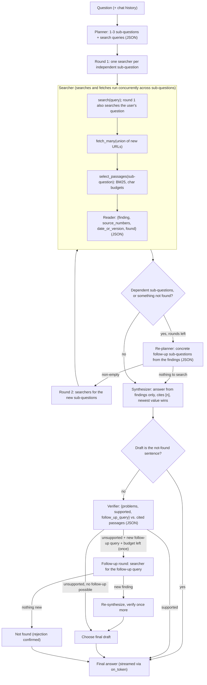

# Multi-agent research mode (`multi`)

`--mode multi` answers with a small team of narrow roles instead of one prompt (`rag`) or one tool-calling loop (`agent`). All roles run on the same local model by default. Every role is a single LLM call with one job, and every role except the final writer returns JSON constrained by a schema (Ollama structured output, `LLM.chat(..., format=schema)`). The design targets 2-4B models. They read and extract reliably, but SearchBench shows they drive a free-form tool loop badly: qwen3.5:2b scores 100% with `rag` but 79% with `agent`, and agent mode gives stale answers on half of the conflicting questions.

```bash
uv run ollamasearch ask "In what year was the company that built the Kalvenna Bridge founded?" \
  --mode multi --backend corpus --corpus bench/corpus
uv run ollamasearch bench --track offline --models qwen3.5:2b --modes rag,multi --out bench/results/x
```

Code: `src/ollamasearch/multiagent.py` (`ResearchPipeline`), prompts and schemas in `src/ollamasearch/prompts_multi.py`, tests in `tests/test_multiagent.py`.

## Data flow



Source numbers are **global for the whole run** (the agent's registry idea). Each URL gets its number the first time any of its passages reaches a role, and keeps it across sub-questions and rounds. So `[3]` means the same page in a reader prompt, a finding, the draft, the verifier's evidence and the final answer. Searches run in a thread pool, one thread per sub-question. Their results are then merged *in sub-question order* before numbering, so numbering and traces are deterministic even though the searches run concurrently. All new URLs of a round are fetched with a single `fetcher.fetch_many` call (concurrent and deduplicated), and pages already fetched in this run are not fetched again.

## Roles and why each exists

| Role | Input | Output | Why it is a separate call |
|---|---|---|---|
| **Planner** | question, last 6 history turns | `{sub_questions: [{question, query, needs_previous}], simple}` | Decomposition is a different skill from reading. A small model asked to plan *and* answer in one go tends to answer from memory. Robust fallback: invalid, empty or garbage JSON gives one sub-question, the question itself. A "simple" plan (or a single sub-question) researches the *original question* with the planner's query, so a sloppy rewording can't change what gets answered. |
| **Searcher** | sub-question + query | ranked passages | No LLM. `backend.search`, `fetch_many`, `rank.select_passages` with the RAG budgets. In round 1 the user's own question is searched alongside the first sub-question's query and the results are merged. On qwen3.5:2b the planner sometimes translates or transliterates names ("Talmyrsk population" for a Russian question, "Kökжайsań" for Kazakh), which BM25 can't match. The anchor search guarantees the readers never see less than RAG would. If a query returns nothing, the searcher retries with the sub-question text. |
| **Reader** | one sub-question + its passages (≤ 6,000 chars) | `{finding, source_numbers, date_or_version, found}` | One narrow extraction per sub-question keeps prompts short. The finding is a self-contained sentence, so later roles never need raw pages. `date_or_version` makes recency explicit for conflicting sources. Invented or boolean source numbers are dropped. A finding without valid citations is assigned the shown source with the largest term overlap. |
| **Re-planner** | question, findings so far, open sub-questions, queries already searched | `{sub_questions: [{question, query}]}` (≤ 2) | Multi-hop: the second hop needs a name that only the first hop's finding contains ("the company that built X" becomes "Kordane Engineering founded"). It runs only when a planned sub-question was marked `needs_previous`, or when some sub-question came back not found. It may return an empty list ("findings already answer it"). If its JSON is invalid, the dependent sub-questions run as originally planned. |
| **Synthesizer** | findings (bullets with `(as of: …)` and `[n]`) + history | plain-text answer | The only user-facing writer. It answers in the question's language (a script-based hint: "Answer in Russian/Kazakh"), combines hops, prefers the most recent value and cites `[n]`. Findings are bullets, not a numbered list, because "1." / "2." got copied as citations. If the draft cites nothing, the sources of its findings are appended. If no finding was found at all, there is no call: the answer is the fixed `NOT_FOUND` sentence. |
| **Verifier** | question, draft, passages of the cited sources (then the findings' sources), ≤ 6,000 chars | `{problems, supported, follow_up_query}` | Catches readers that misread, e.g. qwen3.5:2b reading "founded in 1987" as a founder's birth year on an unanswerable question. It checks the draft against the passages, not the findings, so a reader error can't verify itself. Invalid JSON or an error from the verifier counts as "supported": a broken checker never deletes an answer. |

### Structured output details

The JSON key order is deliberate. Ollama's grammar makes the model emit keys in schema order, so free text comes before the yes/no decision: `finding` before `found`, `problems` before `supported`, `sub_questions` before `simple`. With `found` first, qwen3.5:2b committed to `false` and then wrote the correct answer into `finding`. `parse_json_object` also tolerates code fences and chatter around the object for models or servers without structured output.

### Final-answer rules

1. The latest draft the verifier accepted wins.
2. If no draft was accepted, the answer is `NOT_FOUND` when no finding supports an answer:
   - nothing was found;
   - only *partial* findings (`found: false` but with text and sources) were used;
   - or the verifier rejected the draft, asked for a follow-up, and the follow-up round found nothing new, so two independent signals agree the fact is missing.
3. Otherwise, a single rejection is not trusted over the reader. The draft with the fewest listed problems is kept (the latest on ties).

Partial findings exist because small readers sometimes write the answer and still say `found: false`. The synthesizer may use them only when nothing was marked found, and then the verifier acts as the gate.

## Budgets

| Knob | Source | Default | Meaning |
|---|---|---|---|
| search rounds | `Settings.agent_max_steps` | 4 | Total searcher rounds: round 1, the re-plan round, the verifier follow-up. `1` disables both re-planning and follow-ups. |
| results per search | `Settings.top_k` | 5 | Per query (round 1 merges up to 2 × top_k from query + question). |
| reader passages | `context_char_budget` / `source_char_budget` / `passage_chars` | 6000 / 1500 / 500 | Same as RAG, per reader call. The verifier's evidence uses the same total budget. |
| sub-questions | `max_sub_questions=` kwarg | 3 | Planner output is capped. The re-planner adds ≤ 2. |
| follow-ups | `follow_up_rounds=` kwarg | 1 | Verifier-driven extra rounds (never more than the round budget). A follow-up query that was already searched is not run again. |
| verifier | `verify=` kwarg | `True` | `False` saves one call, and the synthesizer then streams live. |
| per-role models | `role_llms={"plan"/"read"/"synthesize"/"verify": LLM}` | same model | E.g. a larger verifier. Token usage is summed over all models. |

LLM calls per question: plan + one read per sub-question + synthesize + verify, so **4 for a simple question**. Add 1 re-plan and 1-2 reads for multi-hop or gap filling, and up to 3 for a verifier follow-up. Unanswerable questions with nothing found stop after plan, read and re-plan (3 calls, no synthesis).

Streaming: drafts are never streamed, because the verifier may replace them. With verification on, `on_token` receives the final answer once, after verification. With `verify=False` the synthesizer streams token by token. Planner, reader and verifier JSON is never streamed.

## What gets recorded in the `Answer`

- `sources`: every source whose passages reached any role, numbered globally. `context_urls`: the same URLs in order (this drives SearchBench's *gold in context*). `cited`: numbers cited in the final text.
- `tool_calls`: one `ToolCallRecord` per role call, search and fetched URL, named `plan` (the re-planner too), `search`, `fetch`, `read`, `synthesize` and `verify`. `step` is the round (0 = planning). `detail` holds the plan, each finding, the verifier's problems and follow-up query, and "=> final answer: not found" when the final-answer rule removed a draft. `status` is `ok`, `invalid` (non-JSON reply) or `error`.
- `timings`: `plan_s` (planner + re-planner), `read_s`, `synthesize_s`, `verify_s`, `llm_s` (all role calls), `search_s` (wall time of the concurrent search phase), `fetch_s`, `rank_s`, `total_s`.
- `tokens`: `Usage` summed over every call and every role model (`llm.reset_usage()` at start and end, like the other pipelines). `steps`: the number of LLM calls.
- `error`: up to three distinct infrastructure errors (`search: …`, `llm: …`), or `search: no results` when every search came back empty. Failed page fetches are normal on the web and are not run errors; the search snippet stands in for the page.

## How it is scored

`multi` is a regular mode everywhere `build_pipeline` is used, and it is scored exactly like `rag` and `agent`:

- **SearchBench** (`--modes multi`): alias match for correctness; the exact `NOT_FOUND` sentence (shared with `prompts.py`) for abstention on unanswerable questions; *citation hit* from `cited_urls`; *gold in context* from `context_urls` (any role, any round); the stale rate on conflicting questions; latency and tokens from `timings` and `tokens`. The agent-only tool metrics in `summarize_rows` are not computed for `multi`. Use `steps` (LLM calls) and `tool_calls` in `runs.jsonl` instead.
- **External benchmarks** (`--suite <task> --modes multi`) run the same pipeline over the task's documents.

Smoke results (offline track, qwen3.5:2b, temperature 0; small samples, so treat these as sanity checks, not benchmark numbers):

| Run | n | Accuracy | Citation hit | LLM calls / question | p50 latency |
|---|---|---|---|---|---|
| `--limit 8` (single-hop, multi-hop, conflicting, multilingual, unanswerable) | 8 | 8/8 | 100% | 4.1 (4 × 7, 5 × 1) | 3.5 s |
| `--categories unanswerable,conflicting --limit 5` | 5 | 5/5 | 100% | 4.4 | 5.5 s |

For comparison, `rag` with the same model is 100% on the full offline track (42 questions) at 1.0 s p50 and 1,396 mean prompt tokens. `multi` costs about 3.5× RAG's latency and about 2.3× its prompt tokens (3,273 per question in the 8-item run). On this corpus it matches RAG. It is built for the cases RAG can't handle: second hops that BM25 on the question doesn't retrieve, conflicting pages, and wrong readings that a check against the sources catches.

## Limitations

- **The planner rarely decomposes on 2B models.** In probes on SearchBench, qwen3.5:2b returned only the first hop of multi-hop questions and never set `needs_previous`. Multi-hop still works on the offline corpus because the anchor search retrieves both pages and the reader combines them, or because a not-found reading triggers the re-planner. The dependent-round path is exercised by the tests and will matter more with larger planners or on the live web.
- **The verifier has blind spots.** It sees ≤ 6,000 chars of the cited sources. A correct answer whose evidence was cut off can be rejected. That costs a follow-up round, and it ends in `NOT_FOUND` only if the follow-up reader also misses the fact. The verifier can also accept a fluent wrong draft.
- **Latency.** At least 4 sequential LLM calls; on one GPU the reader calls are sequential by design. Searches and fetches overlap, but LLM calls don't.
- **Sources are pre-registered.** Every page whose passages reached a reader is a source (and in `context_urls`), even if no finding used it. This matches RAG's semantics but lists more sources than `agent` does.
- **Language hint is script-based.** Cyrillic with Kazakh-specific letters means Kazakh, other Cyrillic means Russian, and everything else falls back to "the language of the question".
- **Same prompt caveat as the other modes.** Results reflect these prompts; other models may need different few-shot examples in the planner.
